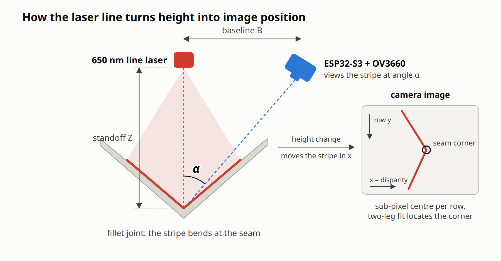
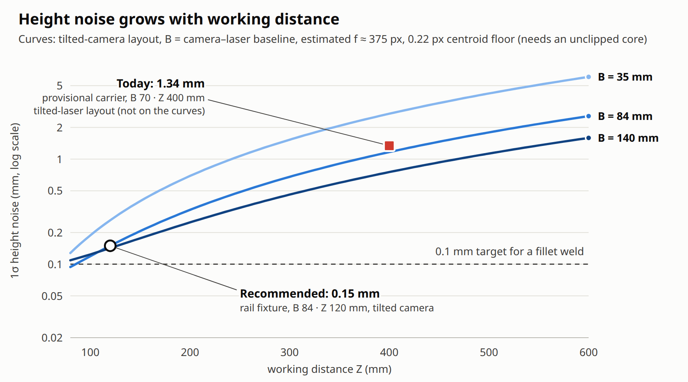
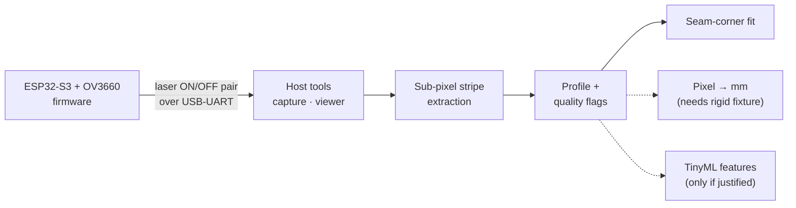
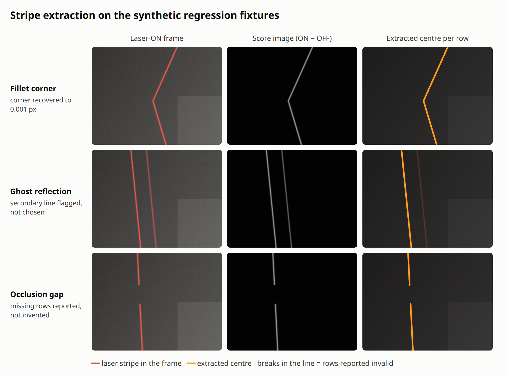

<div align="center">

# ESP32 Laser Triangulation

**Laser-line profiling with a low-cost ESP32-S3 camera board: firmware, host tools and a tested, allocation-free C++ stripe extractor with a Python reference.**

[](https://github.com/juvenile454/esp32-laser-triangulation/actions/workflows/ci.yml)
[](https://github.com/juvenile454/esp32-laser-triangulation/releases)
[](LICENSE)


<picture>
  <source media="(prefers-color-scheme: dark)" srcset="docs/images/measurement-principle-dark.png">
  
</picture>

</div>

> [!WARNING]
> This project switches a **5 mW, 650 nm line laser**: Class IIIa by its US
> label, roughly **Class 3R under IEC 60825-1**. The power is taken from the
> module label, not measured. Never look into the beam or its reflections.
> The firmware has **no maximum laser-on timeout yet**. The live viewer
> switches off after 60 s, but that is no interlock. Keep the manual switch in the
> laser's 5 V lead within reach and never leave the enabled setup unattended.
> See [SECURITY.md](SECURITY.md).

> [!NOTE]
> This is an early research prototype, not a metrology instrument or a
> robot-control system. All measurements stay in **pixels** until a documented
> calibration on a rigid fixture exists.

## Contents

[Highlights](#highlights) · [Where it stands](#where-it-stands) ·
[Try it without hardware](#try-it-without-hardware) · [How it works](#how-it-works) ·
[Hardware](#hardware) · [Quick start](#quick-start) · [Host tools](#host-tools) ·
[Roadmap](#roadmap) · [Documentation](#documentation) · [Safety and scope](#safety-and-scope)

## Highlights

- **Sub-pixel stripe extraction:** a row-wise, score-weighted centre from a
  registered laser ON/OFF pair. It flags saturation, ghost reflections and
  over-wide glare instead of guessing.
- **One algorithm, two implementations:** a readable Python reference and a
  portable, allocation-free C++17 core. They agreed to 0.00003 px on all 480
  rows of a real frame, and CI checks their parity on every synthetic fixture.
- **Seam-corner fit:** two straight legs are fitted to the profile and
  intersected. On the synthetic fillet fixture the corner is recovered to within
  0.001 px.
- **Hardware-verified bring-up:** OV3660 camera on the GOOUUU ESP32-S3-CAM,
  locked exposure, gain and white balance, and a GPIO-switched laser through a
  `2N2222` stage.
- **Honest accuracy budget:** a tool turns baseline and working distance into
  the height noise a layout can reach, before you build it.

## Where it stands

| Quantity | Value | Meaning |
|---|---:|---|
| Stripe-centre repeatability, today | **2.7–3.5 px** | The saturated core splits into two flanks and the centre flips between them. |
| Stripe-centre floor | 0.22 px | Unsaturated columns over 20 static frames. Reachable only once the core stops clipping. |
| Frame-to-frame drift | 0.003 px | The camera lock and mount are stable. |
| Height noise, provisional carrier | 1.34 mm | B ≈ 70 mm, Z ≈ 400 mm, 9.9° angle, at the 0.22 px floor. Geometry limits it. |
| Height noise, recommended rail fixture | ≈ 0.15 mm | B = 84 mm, Z = 120 mm, 35°, at the 0.22 px floor. Not built yet. |
| Firmware footprint | RAM 7.2 % · Flash 5.3 % | ESP32-S3 cross-build. |

Two things limit the system today: the geometry and a clipped (saturated)
stripe core. The sensor is not the limit. Every millimetre figure assumes the
0.22 px floor and an estimated, not yet measured, focal length. The details are
in [docs/GEOMETRY.md](docs/GEOMETRY.md).

<picture>
  <source media="(prefers-color-scheme: dark)" srcset="docs/images/height-noise-dark.png">
  
</picture>

## Try it without hardware

The extractor, the fixtures and the analysis run on any Linux machine with
Python 3.10+:

```bash
python3 -m venv .venv
.venv/bin/python -m pip install -r requirements.txt
.venv/bin/python tools/generate_synthetic_dataset.py --output-dir /tmp/laser/fixtures
.venv/bin/python tools/analyze_laser_pair.py \
  --on  /tmp/laser/fixtures/synthetic_011_fillet_corner/laser_on.png \
  --off /tmp/laser/fixtures/synthetic_011_fillet_corner/laser_off.png \
  --output-dir /tmp/laser/analysis
```

`/tmp/laser/analysis` then holds `overlay.png`, `score.png`, the per-row
`profile.csv` and `result.json` with the measurement summary. Each fixture
directory also contains `truth.csv`, the exact sub-pixel centre the extractor
should find.

## How it works



1. The firmware switches the laser and captures two frames that differ only in
   the laser state.
2. The difference image isolates the stripe from ambient light.
3. Each image row yields a sub-pixel centre, a width and quality flags. Clusters
   that are too wide are rejected before ranking, so a glare field cannot hide a
   real stripe.
4. A fillet weld images as two straight legs, and the fitted corner locates the
   seam from every inlier at once.

The algorithm contract (currently v4), guards and limits are described in
[docs/ARCHITECTURE.md](docs/ARCHITECTURE.md).

<picture>
  <source media="(prefers-color-scheme: dark)" srcset="docs/images/extraction-fixtures-dark.png">
  
</picture>

<sub>Output of the repository's own tools on three of the twelve synthetic
regression fixtures (regenerate with
[`docs/images/source/render_images.py`](docs/images/README.md)). Real captures
stay local and are not part of the repository.</sub>

## Hardware

| Part | Notes |
|---|---|
| GOOUUU ESP32-S3-CAM V1.5 (N16R8) | ESP32-S3 rev 0.2, 16 MiB flash, 8 MiB OPI PSRAM, CH340C USB-UART |
| OV3660 camera (TY-OV3660-2111MI-V3.0) | Sensor PID `0x3660`, VGA 640 × 480 |
| 5 V line-laser module, 650 nm, ≤ 5 mW | `CHT1230`, labelled Class IIIa, measured 13.0 mA |
| `2N2222` NPN transistor | Low-side laser switch |
| 1 kΩ and 10 kΩ resistors | Base resistor and base-emitter pull-down |
| Manual switch | In the laser's 5 V lead, as the physical disconnect |
| Rigid mount (in progress) | Rail fixture; see [GEOMETRY.md](docs/GEOMETRY.md#building-the-rail-fixture) |

```text
5V ── manual switch ── laser + │ laser − ── 2N2222 collector
GPIO14 ── 1 kΩ ──┬── 2N2222 base
                10 kΩ
GND ─────────────┴── 2N2222 emitter
```

Wiring, measurements and the operating limits are in
[docs/LASER_DRIVER.md](docs/LASER_DRIVER.md). The serial commands are in
[docs/FIRMWARE_PROTOCOL.md](docs/FIRMWARE_PROTOCOL.md).

<details>
<summary><b>Camera pin map</b> (matches Espressif's <code>CAMERA_MODEL_ESP32S3_EYE</code>)</summary>

| Signal | GPIO | Signal | GPIO |
|---|---:|---|---:|
| SCCB SDA | 4 | SCCB SCL | 5 |
| VSYNC | 6 | HREF | 7 |
| D2 | 8 | D1 | 9 |
| D3 | 10 | D0 | 11 |
| D4 | 12 | PCLK | 13 |
| XCLK | 15 | D7 | 16 |
| D6 | 17 | D5 | 18 |
| PWDN | -1 | RESET | -1 |

The mapping was verified on hardware by SCCB sensor detection and valid VGA
frame capture. It is defined in
[`include/board_camera_pins.h`](include/board_camera_pins.h).

</details>

## Quick start

You need Linux with Python 3.10+ (CI tests 3.10, 3.12 and 3.13), a C++17
compiler and GNU Make. A board is only required for upload and live capture.

```bash
python3 -m venv .venv
.venv/bin/python -m pip install -r requirements-dev.txt -r requirements-firmware.txt
make check      # C++ tests, sanitizers, C++11 check, ruff, mypy, Python tests
make firmware   # ESP32-S3 cross-build (compile-only)
```

`make check` and `make firmware` run exactly what CI runs.
`requirements.txt` alone is enough for the host tools.

Upload to a board. Identify the port first, because uploading overwrites the
attached device:

```bash
.venv/bin/pio device list
.venv/bin/pio run -t upload --upload-port /dev/ttyUSB0
```

Start the live viewer and open <http://127.0.0.1:8765/>:

```bash
.venv/bin/python tools/live_viewer.py --port /dev/ttyUSB0 --fps 5
```

The viewer shows the live image with a focus indicator, and has controls for
the test LED, camera automation and the laser. It serves only loopback
addresses, and it rejects requests from other origins and requests without its
per-start token. It switches the laser off after `--laser-max-on-s` (default
60 s) or when the page stops polling. Saved frames go to `$LASER_DATA_DIR/live`
(default `data/live` in the repository, ignored by Git).

## Host tools

Every tool prints its options with `--help`. Expected errors end with a
one-line message and exit code 1; usage errors exit with 2.

| Tool | Purpose |
|---|---|
| [`capture_pair.py`](tools/capture_pair.py) | Firmware-switched ON/OFF pair with schema-valid metadata |
| [`capture_frame.py`](tools/capture_frame.py) | One validated JPEG frame |
| [`live_viewer.py`](tools/live_viewer.py) | Localhost MJPEG viewer with camera, LED and laser controls |
| [`analyze_laser_pair.py`](tools/analyze_laser_pair.py) | Offline extraction with overlay, score map, CSV and JSON (exit 3 = invalid profile) |
| [`laser_pipeline.py`](tools/laser_pipeline.py) | Python reference implementation of the extractor |
| [`generate_synthetic_dataset.py`](tools/generate_synthetic_dataset.py) | Twelve deterministic fixtures with exact pixel truth |
| [`validate_dataset.py`](tools/validate_dataset.py) | JSON-schema, image hash and dimension checks |
| [`fit_calibration.py`](tools/fit_calibration.py) | Robust pixel → mm fit with held-out validation; header export only with `--fixture-revision` |
| [`triangulation_budget.py`](tools/triangulation_budget.py) | Accuracy budget of a layout; focal length from a measured step |
| [`seam_displacement.py`](tools/seam_displacement.py) | Teach-and-compare part locating model and its limits |
| [`build_profile_features.py`](tools/build_profile_features.py) | Provisional 69-float TinyML feature vector |

The tools share [`serial_protocol.py`](tools/serial_protocol.py) for framing and
checksums and [`cli_common.py`](tools/cli_common.py) for argument validation.
Large or generated files (captures, datasets, firmware images) never go into
Git. Tools that write data use `$LASER_DATA_DIR`, or `data/` if it is not set.

## Repository layout

```text
src/              ESP32-S3 firmware (Arduino framework)
include/          board pin map
lib/laser_core/   portable, allocation-free C++17 stripe extractor
host/             native command-line wrapper around the C++ core
tools/            Python capture, analysis, calibration and planning tools
tests/            C++ unit tests and Python tests, including C++/Python parity
schemas/          versioned capture-metadata schema
examples/         metadata of real captures (the images stay local)
docs/             status, protocol, architecture, geometry, laser driver, checklist, lab log
ml/               TinyML decision boundary (no model yet)
boards/           PlatformIO board definition
```

## Roadmap

- [x] Camera bring-up, framed UART transport and localhost viewer
- [x] Hardware-verified exposure, gain and white-balance lock
- [x] GPIO14 / `2N2222` laser driver, verified on hardware
- [x] Portable C++ extractor with Python parity, sanitizers and twelve fixtures
- [x] Seam-corner fit and the geometry accuracy budget
- [x] Host-side laser limit and cross-origin protection in the live viewer
- [ ] Maximum laser-on timeout in firmware ([draft PR #3](https://github.com/juvenile454/esp32-laser-triangulation/pull/3)), then a supervised soak test
- [ ] Rigid rail fixture with a 30–45° triangulation angle
- [ ] Unclipped stripe core: lower exposure and gain, 650 nm band-pass filter
- [ ] Measured focal length, then pixel → mm calibration with held-out validation
- [ ] Extraction running on the ESP32-S3, with timing and memory measured
- [ ] TinyML only if it beats the frozen classical baseline on real held-out data

## Documentation

| Document | Contents |
|---|---|
| [Status](docs/STATUS.md) | What is verified, blocked and still open |
| [Firmware protocol](docs/FIRMWARE_PROTOCOL.md) | Serial commands, replies, camera lock, pins |
| [Architecture](docs/ARCHITECTURE.md) | Data flow, algorithm contract, seam fitting, part locating |
| [Measurement geometry](docs/GEOMETRY.md) | Triangulation model, accuracy budget, fixture design |
| [Laser driver](docs/LASER_DRIVER.md) | Circuit, measurements, executed validation, operating limits |
| [Hardware checklist](docs/CHECKLIST.md) | Step-by-step bring-up and calibration procedure |
| [Lab log](docs/LAB_LOG.md) | Dated experiments and verified results |
| [TinyML boundary](ml/README.md) | When a learned model would be justified |
| [Examples](examples/README.md) and [sample schema](schemas/sample.schema.json) | Versioned capture metadata |
| [Changelog](CHANGELOG.md) | Notable changes per release |

## Contributing

Contributions are welcome, especially measurements on real hardware. Please read
[CONTRIBUTING.md](CONTRIBUTING.md) and the [code of conduct](CODE_OF_CONDUCT.md)
first. Report security or safety problems privately as described in
[SECURITY.md](SECURITY.md).

## Safety and scope

Nothing in this repository is authorised to command a robot, welding system or
production machine. Laser safety, the machine-integration boundary and how to
report problems are covered in [SECURITY.md](SECURITY.md).

## License

Licensed under the [Apache License 2.0](LICENSE). The software is provided
"as is", without warranty of any kind.

## Acknowledgements

The camera pin map was cross-checked against:

- [profharris/GOOUUU_ESP32-S3-CAM](https://github.com/profharris/GOOUUU_ESP32-S3-CAM)
- [zhuhai-esp/ESP32-S3-Goouuu-Cam](https://github.com/zhuhai-esp/ESP32-S3-Goouuu-Cam)
- Espressif's Arduino `CameraWebServer` example, profile `CAMERA_MODEL_ESP32S3_EYE`
