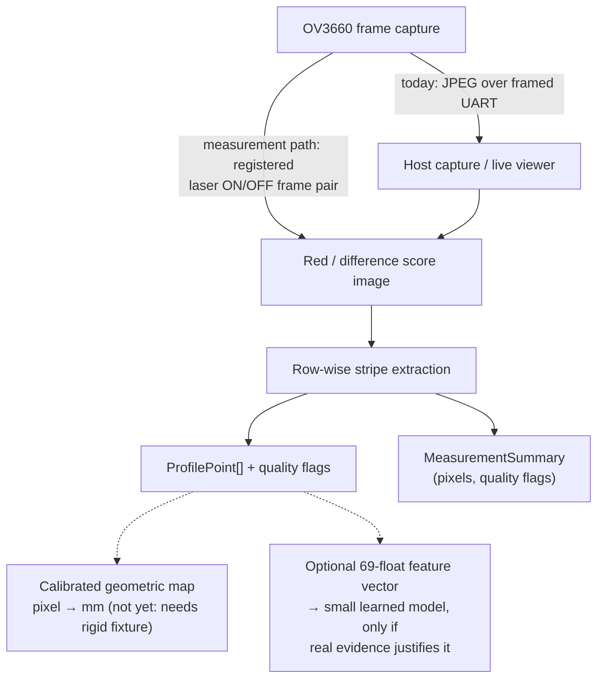

# Architecture

## Objective

The project is an experimental, auditable laser-triangulation pipeline for the GOOUUU ESP32-S3-CAM V1.5 with OV3660 camera. It deliberately separates deterministic stripe extraction, geometric calibration and optional learned post-processing. Values remain in pixels until a measured rigid-fixture calibration is available.

## Data flow



## Components

### Firmware

- `src/main.cpp`: board bring-up, PSRAM/camera checks, JPEG capture, framed serial transport, test-light control, camera-automation commands, exposure/gain setters, laser switching, registered-pair capture and an RGB565 measurement frame.
- `include/board_camera_pins.h`: verified GOOUUU/OV3660 pin mapping.
- `docs/LASER_DRIVER.md`: hardware-verified GPIO14/2N2222 wiring, measurements, executed switch test and operating limits.
- `src/laser_contract_compile_check.cpp`: forces the portable extraction and feature contracts through the ESP32 toolchain.
- `boards/goouuu_esp32_s3_cam_v1_5.json`: local PlatformIO board definition.

### Portable extraction core

- `lib/laser_core/src/laser_core.h/.cpp`: allocation-free C++17 stripe extraction from RGB888 images.
- Inputs and output storage are caller-owned and bounded.
- Each scan row yields a `ProfilePoint` with sub-pixel centre, width, peak, saturation and secondary-candidate flags.
- `MeasurementSummary` reports coverage, confidence and an explicit invalid reason.

### Host reference and tooling

- `tools/laser_pipeline.py`: dependency-light Python reference implementation.
- `tools/analyze_laser_pair.py`: offline ON/OFF analysis with score image, overlay, CSV and JSON diagnostics.
- `tools/generate_synthetic_dataset.py`: deterministic image pairs and exact pixel truth.
- `tools/validate_dataset.py`: schema-critical fields, image hashes and dimensions.
- `tools/fit_calibration.py`: robust polynomial calibration, held-out validation, residuals, plot and C++ header export.
- `tools/build_profile_features.py`: provisional 69-value feature contract; it does not train a model.
- `tools/capture_pair.py`: firmware-switched registered ON/OFF pair with schema metadata and a UTC timestamp.
- `tools/triangulation_budget.py`: turns baseline, working distance and focal length into the accuracy the layout can reach; derives focal length from a measured height step.
- `host/laser_cli.cpp`: native PPM wrapper around the same portable C++ core.

## Algorithm contract

Contract version 4 (`laser::kContractVersion`, `CONTRACT_VERSION` in Python). For every image row in the configured ROI:

1. Compute a red-sensitive score, optionally using the registered laser-OFF frame.
2. Form contiguous above-threshold clusters.
3. With a registered OFF frame, bridge only a bounded bright low-chroma gap whose pixels are individually laser-induced; this prevents a clipped neutral-white or warm yellow-white core from becoming two false red stripes.
4. Reject clusters wider than the configured maximum. Rejection happens **before** ranking, so a broad specular field can never displace a genuine narrow stripe that is also present.
5. Rank the surviving clusters. A candidate whose centre lies within `prediction_window_px` of the running prediction outranks one that does not; strength only separates candidates in the same tier. Setting the window to 0 restores pure strongest-cluster selection.
6. Record a relevant, genuinely separate second cluster as a reflection/ghost warning.
7. Calculate the selected cluster's score-weighted sub-pixel centre. Only a *tracked* selection (inside the window) moves the prediction for the next row; an untracked one is reported but does not capture the window. Without a prediction yet, or with the window at 0, every selection seeds it.
8. Aggregate coverage, saturation, ambiguity and signal strength into a measurement summary.

If a row has candidates but all of them are over-wide, the row reports
`too_wide` and keeps the strongest rejected candidate for diagnostics. When that
holds for every row the summary reason is `all_clusters_too_wide`, kept distinct
from `no_stripe`: a glare field and an unlit scene need different responses.

`MeasurementSummary::confidence` is a **quality score, not a probability**, and
it is not calibrated against any ground truth. Two of its four factors are inert
in practice: `signal_quality` saturates whenever the mean peak exceeds twice the
threshold, which real captures always do. Use the explicit flags (coverage,
saturation, secondary candidates, invalid reason) for decisions, and treat the
score only as a coarse ranking of captures.

Configuration values are checked before any pixel is read. Non-finite or
out-of-range `ghost_ratio`, `minimum_valid_ratio`, `prediction_window_px` and
`initial_prediction_px` return `kBadArgument` (C++) or raise `ValueError`
(Python), so NaN can no longer switch off the coverage gate or the ghost flag.
A `false` return from the C++ entry points means a bad argument, a dimension
mismatch or too little output space. Whether the measurement is usable is
reported separately in `MeasurementSummary::valid`.

### Continuity tracking, and what it does not fix

Contract v4 closed a hole in v3: when the stripe was missing on a single row, a
bright blob outside the window could be selected and then pulled the
prediction onto itself for its whole length. The prediction now ignores
untracked picks. The flip side is that a genuine step larger than the window
falls back to strongest-cluster selection until the stripe re-enters the
window; seed each frame with `initial_prediction_px`.

Tracking defends against candidates that are spatially separated from the true
stripe: ghost reflections, specular blobs on blank steel. It does not rescue a
saturated core, whose two red flanks sit only a few pixels apart. Measured on
real frames, tracking changed the centroid spread from 3.47 px to 2.70 px at
best — still an order of magnitude above the 0.22 px sensor floor. Clipping is
an optical problem; see [GEOMETRY.md](GEOMETRY.md).

## Seam feature fitting

A fillet weld images as two straight legs meeting at a corner. `fitSeamCorner`
fits `x = a + b*y` independently before and after every admissible split, keeps
the split with the smallest combined squared error, and intersects the two
fitted legs.

This matters more than it first appears: the corner is located from every
inlier at once, not from a single profile point. On the synthetic fillet fixture
the corner is recovered to within 0.001 px of truth.

Guards: both legs must hold `minimum_leg_points` and `minimum_leg_fraction` of
the valid points, the profile direction must turn by at least
`minimum_corner_deviation_deg`, the combined residual must stay under
`maximum_rms_px`, and the intersection must fall inside the measured span. A
straight profile therefore reports no corner rather than an extrapolated one.
The leg fraction exists because pixel quantisation near either end of a straight
profile otherwise fits a short flat leg against a long sloped one.

The result stays in pixels. Converting it to millimetres is the calibration
layer's job.

## Calibration boundary

`tools/fit_calibration.py` supports linear and quadratic mappings:

```text
physical_mm = c0 + c1 * observed_px + c2 * observed_px^2
```

Generated coefficients are meaningful only when all input points come from a documented, rigid fixture and held-out validation stays within a separately defined acceptance criterion. Synthetic calibration output is solely a software test.

## TinyML boundary

TinyML is optional and downstream of deterministic extraction. The provisional feature contract contains 64 normalised profile values plus five quality features. No model is part of the repository. A model is justified only if a frozen classical baseline loses on representative held-out real data and the improvement survives on-device resource and latency checks.

## Persistent versus generated content

Source, schemas, examples and documentation belong in Git. Captures, factory-flash backups, generated datasets, compiled firmware, calibration outputs and model binaries stay outside Git. Tools that write data use `$LASER_DATA_DIR`, or the repository's `data/` directory (ignored by Git) when it is not set.

## Teach-and-compare part locating

The intended production use is not absolute metrology. A reference part is
taught and scanned; a later part is scanned along the same programmed path, and
the difference becomes a path correction. `tools/seam_displacement.py` models
that scheme and is the reference for what it can and cannot deliver.

The useful consequence: **the laser's orientation relative to a seam does not
have to be known or ideal.** Whatever it is, the reference scan absorbs it, and
the recovered displacement is exact at every crossing angle. Hand-eye
calibration is still needed to express the answer in robot coordinates, but the
seam-by-seam alignment is not a constraint.

Three limits survive that argument:

1. **Each scan is blind along its own seam.** A laser plane crossing a seam
   yields two numbers. Displacement along the seam slides it along itself and
   moves nothing in the image. Scanning seams that all run the same way leaves
   that component permanently unmeasured — ten parallel seams give rank 2 of 3
   for a pure translation, exactly as two parallel ones do.
2. **Direction alone is not enough; placement matters too.** A scan set with
   three different seam directions can still be blind to a rotation if every
   scan sits where that rotation slides its seam along its own length. The
   worked example in the tool has rank 5 of 6 for exactly that reason. Spread
   the scans across the part, and scan long seams at both ends.
3. **Orientation is free for correctness, not for precision.** A shallow
   crossing flattens the corner in the profile, and two legs meeting at angle
   gamma intersect with an uncertainty scaling as `1/sin(gamma)`. Above a 45°
   crossing the penalty stays under 1.1x; at 15° every measurement is twice as
   noisy.

Two non-parallel seams determine a pure translation. Six well-spread scans in
three directions determine a full rigid displacement with a noise gain of about
0.66 (section 6 of the `seam_displacement.py` output), that is below 1,
meaning the least-squares fit averages measurement error down rather than
amplifying it.

### Locating the fixture instead of the welds

The staged version of the same idea is to correct the **work frame** rather than
the tool path: scan the edges of the bolted base plate, solve for how the whole
fixture moved, and shift every taught position with it. That is what FANUC's
user-frame shift and commercial part-locating packages do, and it is a strictly
easier problem than seam tracking.

It is better conditioned, not just simpler. Eight scans across the four edges of
a 400 × 300 mm plate, taken near the corners, give:

| Scan set | Rigid rank | In-plane rank | In-plane noise gain |
|---|---:|---:|---:|
| Four corners, both edges each | 6 of 6 | 3 of 3 | 0.25 |
| Two opposite corners | 6 of 6 | 3 of 3 | 0.50 |
| One corner | 4 of 6 | 2 of 3 | unsolvable |

Compare the 0.25 against the 0.66 of the six well-spread seam scans above: a plate's edges run
in two perpendicular directions and can be scanned at widely separated points,
which rules out both degeneracies by construction rather than by careful
planning.

A single corner locates a point but not an orientation — its two scans yield two
useful in-plane numbers against three unknowns. Two opposite corners are the
practical minimum.

The important caveat is that a frame correction only tracks the **fixture**. It
cannot see a workpiece shifting inside the fixture, or part-to-part variation in
the seams themselves. It is the first stage, not a replacement for seam
measurement.

## Pose and trajectory boundary

A profile states that the seam is some distance from where the laser currently
points. Turning a series of those into a machine correction additionally needs,
for every frame: the robot pose at capture time, a sensor-to-TCP transform from
a hand-eye calibration, and time synchronisation between the two.

None of that exists yet. What does exist is the place to put it:
`capture.timestamp_utc` is now required by the sample schema and
`capture.robot_pose` is accepted whenever it becomes available, so captures made
during the fixture phase stay usable once the pose layer is built.

Note also that `tools/fit_calibration.py` fits a one-dimensional polynomial. That
is correct for a single height reading. The full transform is two-dimensional —
(position along the stripe, disparity) to (y, z) in sensor coordinates, then a
rigid transform into robot coordinates.

## Current limitations

- The portable core is compiled and unit-tested for ESP32 but has not run on the board.
- The RGB565 measurement path is written and cross-compiled but not hardware-verified. The current firmware only switches the sensor's pixel format while the driver stays configured for JPEG, which very likely makes `M` fail; draft PR #7 re-initialises the driver instead.
- GPIO14 laser switching and the localhost viewer's `0/1/0` path are hardware-verified through the completed `2N2222` stage. The viewer now limits on-time on the host side; a firmware maximum-on time (draft PR #7), a final-fixture `R` capture and a multi-hour soak remain pending.
- The stripe core is saturated, which costs roughly an order of magnitude of centre precision.
- No rigid-fixture pixel-to-millimetre calibration exists, and the focal length is estimated rather than measured.
- Thresholds, runtime, PSRAM pressure and optical accuracy are not production claims.
